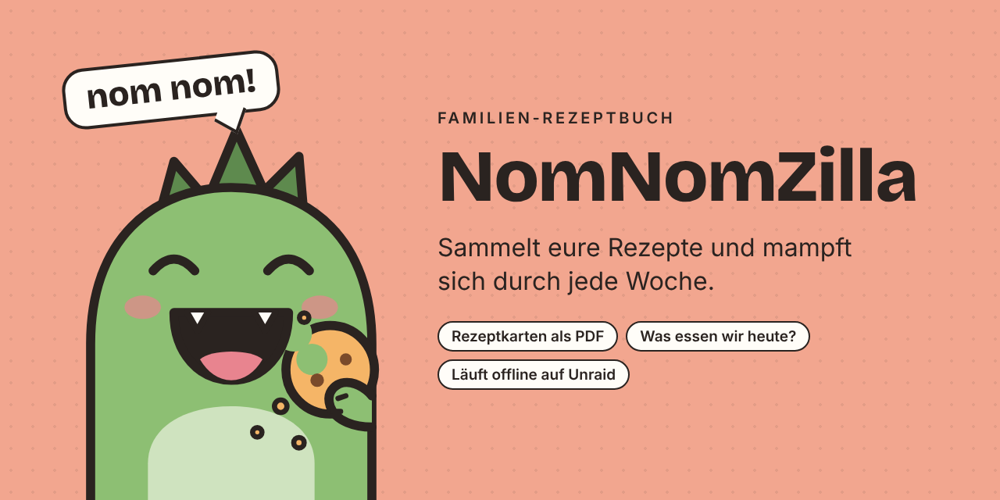

# NomNomZilla



**Website:** [marwaeck.github.io/nomnomzilla](https://marwaeck.github.io/nomnomzilla/)

Das Familien-Rezeptbuch für den eigenen Server. Läuft als Docker-Container, zum Beispiel auf Unraid, und ist im Heimnetz von jedem Gerät per Browser erreichbar.

- **Rezepte suchen und gruppieren** nach Kategorie, Küche, Ernährung, Zeit, Schwierigkeit, Saison, Hauptzutat oder Stichwort
- **Rezeptkarten exportieren** als DIN-A4-PDF, PNG oder HTML, auch mehrere Karten in einem PDF
- **„Was essen wir heute?“**: vier kurze Fragen, dann ein Vorschlag aus euren Rezepten, bevorzugt was länger nicht gekocht wurde
- **Live-Abgleich**: Was auf einem Gerät gespeichert wird, erscheint sofort auf allen anderen
- **Eigene Rezeptkarten-PDFs hochladen**, auch mehrere auf einmal, ganz ohne Internet
- **Import aus fremden PDFs und Text** mit Claude (optional, siehe unten)

Kartenexport, Suche, Assistent und Bearbeiten laufen komplett im Container und im Browser. Es werden keine externen Dienste, CDNs oder Schriften aus dem Internet geladen.

## Installation auf Unraid

### Variante A: Template einmal hinterlegen (empfohlen)

1. Im Unraid-Terminal:
   ```sh
   wget -O /boot/config/plugins/dockerMan/templates-user/my-NomNomZilla.xml \
     https://raw.githubusercontent.com/Marwaeck/nomnomzilla/main/unraid/nomnomzilla.xml
   ```
2. **Docker** → **Container hinzufügen** → bei „Vorlage“ **NomNomZilla** auswählen.
3. Optional Passwort und Anthropic-API-Schlüssel eintragen, dann **Anwenden**.
4. Die App ist unter `http://<unraid-ip>:6767` erreichbar.

### Variante B: Ohne Template

Docker → Container hinzufügen, und von Hand eintragen:

| Feld | Wert |
|---|---|
| Repository | `ghcr.io/marwaeck/nomnomzilla:latest` |
| Port | Container `8080` → Host `6767` (oder ein anderer freier Port) |
| Pfad | Container `/data` → Host `/mnt/user/appdata/nomnomzilla` |

### Updates

Jeder Push auf `main` baut über GitHub Actions automatisch ein neues Image. In Unraid erscheint dann bei NomNomZilla „Update verfügbar“, ein Klick genügt. Die Rezepte in `/data` bleiben dabei erhalten.

## Einstellungen

| Variable | Pflicht | Bedeutung |
|---|---|---|
| `APP_PASSWORD` | nein | Wenn gesetzt, fragt der Browser einmal nach Benutzername (beliebig) und Passwort. |
| `ANTHROPIC_API_KEY` | nein | Schaltet den Claude-Import für fremde PDFs und Text frei. Eigene Rezeptkarten lassen sich auch ohne Schlüssel hochladen. |
| `ANTHROPIC_MODEL` | nein | Modell für den Import, Standard `claude-sonnet-5-5`. |
| `PUID` / `PGID` | nein | Besitzer der Dateien in `/data`, Standard `99`/`100` (Unraid nobody:users). |
| `PORT` | nein | Interner Port, Standard `8080`. |

### Eigene Rezeptkarten hochladen

Über **Importieren** lassen sich PDFs im NomNomZilla-Kartenlayout hochladen, auch mehrere Dateien und mehrseitige PDFs auf einmal. Das läuft komplett im Browser, ohne API-Schlüssel und ohne Internet.

- **PDFs aus dem Export** der App enthalten die Rezeptdaten unsichtbar in den Metadaten und kommen exakt so zurück, wie sie gespeichert waren.
- **PDFs nach demselben Muster**, zum Beispiel eine als PDF gedruckte HTML-Karte, werden anhand des Layouts gelesen: Titel, Untertitel, Kategorie und Stichwort aus der Kopfzeile, Menge, Zeit, Kochgeschirr, Zutaten, Tipp, Schritte (mit **fett**) und die Farbe der Kopfzeile. Auch freiere Varianten werden verstanden: eigene Merkmale statt Menge/Zeit/Kochgeschirr (z. B. Gesamtzeit, Ergibt, Backen), Zwischenüberschriften bei den Zutaten, Kästen wie „Hinweis“ oder „Backform“ und Karten mit nummerierten Varianten statt Zutatenliste. Was keinen eigenen Platz auf der Karte hat, landet im Tipp. Ernährung, Hauptzutat und Illustration werden geschätzt. Küche, Schwierigkeit und Saison stehen meist nicht auf der Karte und bleiben dann leer.
- **Ein einzelnes Rezept** öffnet sich zum Prüfen im Editor. Mehrere werden direkt gespeichert; Rezepte mit einem Titel, den es schon gibt, werden übersprungen.
- PDFs aus Versionen vor diesem Update enthalten die Karte nur als Bild. Die lassen sich nur mit dem Claude-Import lesen.

### Import mit Claude scharfschalten

1. Unter [console.anthropic.com](https://console.anthropic.com) einen API-Schlüssel anlegen und etwas Guthaben aufladen.
2. Den Schlüssel im Unraid-Template bei „Anthropic API-Schlüssel“ eintragen und den Container neu starten.
3. Unter **Importieren** kannst du jetzt auch fremde PDFs und Text einlesen. PDFs mit Text kosten pro Rezept etwa einen Cent, gescannte Seiten etwas mehr, weil jede Seite als Bild gelesen wird.

Der Schlüssel bleibt auf dem Server, der Browser bekommt ihn nie zu sehen.

## Wenn der Container nicht startet

- **Port belegt:** Meldet Unraid beim Start „port is already allocated“, ist der Host-Port schon vergeben. Im Template einen anderen Port eintragen. Ports 6665–6669 meiden, die blockieren Browser.
- **Log ansehen:** Docker-Tab → NomNomZilla-Symbol → **Logs**. Bei einem normalen Start steht dort „NomNomZilla läuft auf Port 8080“.
- **Rechte:** Der Container übernimmt `/mnt/user/appdata/nomnomzilla` beim Start selbst für `PUID:PGID` (99:100).

## Daten und Sicherung

Alle Rezepte liegen in `/mnt/user/appdata/nomnomzilla/recipes.json`. Nimm den Ordner in dein Appdata-Backup auf. Zusätzlich lädt der Button **Sicherung herunterladen** in der App die aktuelle Datei herunter. Zum Wiederherstellen legst du sie einfach wieder als `recipes.json` in den Ordner und startest den Container neu.

Beim allerersten Start ohne Daten wird die Bacon-One-Pot-Pasta als Beispielrezept angelegt.

## Von außerhalb des Heimnetzes

Am einfachsten über ein VPN (z. B. WireGuard in Unraid oder Tailscale). Wenn du NomNomZilla über einen Reverse Proxy ins Internet stellst, setz unbedingt `APP_PASSWORD` und nutze HTTPS.

## Lokal starten (ohne Docker)

```sh
DATA_DIR=./data node server.js
```

Node.js 22 genügt, es gibt keine Abhängigkeiten. Für Kartenexport und PDF-Import müssen die Dateien aus dem `vendor`-Schritt im `Dockerfile` unter `public/vendor/` liegen.

## In der Unraid-App-Liste veröffentlichen

Damit NomNomZilla unter **Apps** (Community Applications) für alle auftaucht:

1. Repo öffentlich lassen, Template liegt unter `unraid/nomnomzilla.xml`.
2. Im [Unraid-Forum](https://forums.unraid.net/) einen Support-Thread anlegen und dessen Link als `<Support>` im Template eintragen.
3. Das Repo bei Community Applications einreichen (Anleitung im Forum-Bereich „Docker Containers“ → „Community Applications“).

## Projekt-Website

Die Website unter [marwaeck.github.io/nomnomzilla](https://marwaeck.github.io/nomnomzilla/) liegt im Ordner `docs/` und wird mit Jekyll gebaut. Jeder Push auf `main`, der `docs/` ändert, veröffentlicht sie über GitHub Actions neu. Lokal ansehen: `jekyll serve -s docs`.
